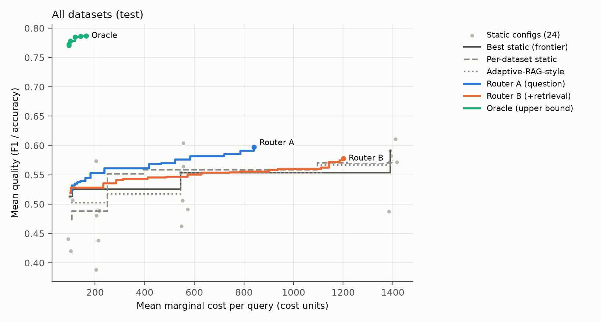
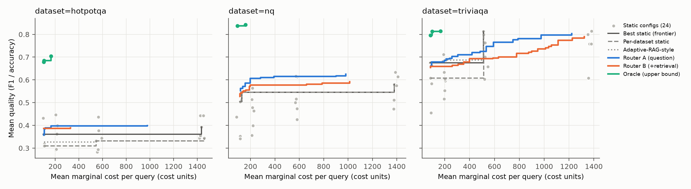

# Mid-submission report (Fri 31 Oct 2026)

**Which RAG Configuration for Which Query? Cost-Aware Per-Query Configuration Routing**

**Team: Agents** · Course: IRE · Final deadline: Fri 21 Nov 2026

| Name | Roll number |
|---|---|
| Samyak Jain | 2024101062 |
| Arnav Agnihotri | 2024101103 |
| Sherley Sonali Peethala | 2023111022 |

Detailed decision records: docs/02_experiment_design.md.

---

## 1. Problem and goal
RAG pipelines have many interacting configuration choices: retriever, how many passages to read (top-k),
whether to rerank, and which generator to use. Benchmark studies (Wang et al., EMNLP 2024) and AutoML
tools (AutoRAG; AutoRAG-HP; Orbach et al. 2025) search for **one** good configuration per dataset, and
most report answer quality without generation-side cost.

We ask two questions:
1. **Is there per-query headroom?** If we run every configuration on every question, how much better is
   choosing the best configuration *per question* (the oracle) than the single best static configuration,
   at equal cost? How much of that gap is noise?
2. **Can it be predicted cheaply?** Can a router choose a configuration from the question alone (Router A),
   or from the question plus cheap post-retrieval signals (Router B, signal cost charged)?
3. **One router for all tasks, or one per task?** The study covers **three tasks**: open-domain QA (NQ-open,
   HotpotQA, TriviaQA), fact verification (FEVER) and slot filling (zsRE). Each task has its own metric. We
   train every router both **globally** (one router over all tasks) and **per task** (one router per task),
   and compare them on the same test questions (§3.7).

Research questions RQ1–RQ5 and hypotheses H1–H4 are listed in docs/01_proposal.md §3.

## 2. Related work (summary)
| Work | Relation to us |
|---|---|
| Wang et al., *Searching for Best Practices in RAG*, EMNLP 2024 | One recommended recipe per setting; we test whether the recipe should vary per query. |
| AutoRAG (Kim et al., arXiv:2410.20878) | **Our harness.** Its node-wise greedy search prunes the grid; we run one module per node in stages so every cell exists. |
| AutoRAG-HP (Fu et al., Findings of EMNLP 2024) | Bandit tuning beats grid search for *finding* one config; we need the full grid for oracle labels. |
| Orbach et al., arXiv:2505.03452 (AAAI 2026 workshop) | HPO for RAG per dataset; their "choose the model first" result is a prior for our generator feature. |
| Adaptive-RAG (Jeong et al., NAACL 2024) | Closest per-query baseline (question-complexity classifier); we add retrieval signals and a cost objective. |
| METIS (Ray et al., SOSP 2025) | Online per-query configuration adaptation for serving latency; discussed, not reproduced. |
| RAGAS (Es et al., EACL 2024 demo) | Secondary LLM-judge metric, only after a 150-item human validation. |

All eight core references were checked against arXiv / ACL Anthology (title, authors, venue, IDs).
The dataset, model, method and tool references (9–25) were checked the same way on 28 Oct.

## 3. Experimental setup

### 3.1 Data: three tasks, five datasets
The three QA datasets are one task (open-domain QA), so we add two other tasks: fact verification and slot
filling. All five datasets use the same DPR Wikipedia index.

| Task | Dataset | Type | Full split used | Sampled (full run) | Pilot |
|---|---|---|---|---|---|
| 1. Open-domain QA | NQ-open (HF `validation` = standard NQ-open test set) | single-hop, open-domain | 3,610 | 1,000 | 100 |
| 1. Open-domain QA | HotpotQA (distractor, validation; questions/answers/supporting titles only) | multi-hop (bridge / comparison) | 7,405 | 1,000 | 100 |
| 1. Open-domain QA | TriviaQA (unfiltered.nocontext, validation) | single-hop, trivia | 11,313 | 1,000 | 100 |
| 2. Fact verification | FEVER (KILT, validation) | claim → SUPPORTS / REFUTES | 10,444 | 1,000 | – |
| 3. Slot filling | zsRE (KILT `structured_zeroshot`, validation) | "subject \| relation" → missing entity | 3,724 | 1,000 | – |

Sampling is seeded and stratified (HotpotQA by question type, FEVER by label). The full split sizes above
were checked against the data (FEVER and zsRE on 30 Oct). **The pilot covered only the QA task.** FEVER and
zsRE are fully implemented (loaders, prompts, metrics, gold-passage mapping; the zsRE loader was checked on
real validation rows) and enter in the full run.

**Grouped split.** Questions that share a gold Wikipedia title are joined with union-find and kept in the
same split, so the test set never shares a gold article with training. The split is 60/20/20 per dataset.
A giant-component guard stops the split if one group exceeds 5% of the data.

Pilot split (measured, job A):
| | train | dev | test |
|---|---|---|---|
| per dataset | 60 | 20 | 20 |
| total | 180 | 60 | 60 |

Leakage report (pilot): test questions sharing any gold title with train = **0.0**; duplicate questions
across splits = 0; 298 groups, largest group = 2 questions; no hub titles.

### 3.2 Corpus
- DPR 100-word Wikipedia passages (Karpukhin et al. 2020): **21,015,324** passages, 4.69 GB compressed.
  Chunking is fixed (design decision D3).
- **Sub-corpus.** AutoRAG keeps its BM25 index (`rank_bm25`) and the corpus in memory, so 21M passages do
  not fit. We build a sub-corpus that contains each question's **full-corpus BM25 top-100** (mined with a
  Pyserini Lucene index of the same 21M passages), the passages of gold articles, and random fill. Every
  retriever therefore still faces the hard negatives it would face on the full corpus.
  - Full run: ~1M passages. Pilot: 100,000 passages.
- Pilot sub-corpus (measured):
  | Item | Value |
  |---|---|
  | Mined passages (300 questions × top-100) | 30,000 hits → 29,859 unique |
  | Gold-article neighbour passages | 826 |
  | Random fill | 69,315 |
  | Total | 100,000 |
  | Questions with ≥1 gold passage in the sub-corpus: HotpotQA / TriviaQA / NQ | 0.97 / 0.88 / 0.79 |
- **Gold definition.**
  - HotpotQA: the intro passages of its supporting-fact titles.
  - NQ and TriviaQA: mined passages whose normalised text contains a normalised gold answer (DPR's
    "has_answer" heuristic).
  - Questions with no gold passage are kept and flagged, not dropped, to avoid selection bias. They still
    count for answer EM/F1, but not for retrieval recall.
  - 168 of the 200 HotpotQA gold titles were found in the DPR dump. We checked all 32 misses against all
    21M DPR passages (Ada job 44382):
    | Cause | Titles |
    |---|---|
    | Same title, different Unicode form of accents (e.g. "Václav Havel") | 6 |
    | HTML entities in HotpotQA titles (`&amp;`, `&quot;`) | 3 |
    | Only a different article with the same base name, e.g. "Splendor (board game)" vs "(1999 film)": not a match | 2 |
    | No exact, accent, case, HTML or disambiguation-free match | 21 |

    The first 9 were a matching bug on our side, now fixed: titles are normalised on both sides, with a
    regression test. The remaining 23 are absent from DPR's Dec 2018 dump under these variants, most
    likely because the articles were renamed or deleted after HotpotQA's 2017 dump. The pilot numbers
    above use the old matching; the full run uses the fix. 29 of the 100 pilot HotpotQA questions involve
    at least one missed title. They are still counted for answer F1/EM; only their retrieval
    gold set is incomplete.

### 3.3 Configuration grid (24 configurations)
| Factor | Levels |
|---|---|
| Retriever | BM25 · dense (`BAAI/bge-base-en-v1.5`, Chroma) · hybrid (RRF, k = 60, fixed) |
| Top-k passages to the generator | 3 · 10 |
| Reranker | off · `cross-encoder/ms-marco-MiniLM-L-6-v2` on a fixed pool of 20 |
| Generator | Qwen2.5-1.5B-Instruct · Qwen2.5-7B-Instruct (greedy, max 32 new tokens) |

### 3.4 Harness (AutoRAG, staged and cached)
AutoRAG 0.3.27 normally keeps only the best module after each node, so most of the 24 cells would never
be run. We use AutoRAG modules but run the pipeline in stages:
1. One retrieval trial runs all three retrievers at top-20.
2. The reranker runs once on the 20-passage pool.
3. Generation runs per generator over the 12 retrieval variants.

Top-3 and top-10 are prefixes of top-20.
- **Checked locally:** prefix equality was 1.0 for all three retrievers. The reranker keeps the same
  passage IDs. Retrieval features had no NaN.
- **Equivalence check:** `harness/check_equivalence.py` compares sampled cells with AutoRAG's own
  end-to-end pipeline (Ada job 44097; 50 questions per config, Qwen 1.5B):
  | Check | Result |
  |---|---|
  | Retrieved passage ids, staged vs AutoRAG end-to-end (BM25-k10; hybrid-k3-rerank) | 100% / 100% identical |
  | Generated answers, same comparison | 100% / 94% identical |
  | Our input-token count vs llama.cpp's own prompt count (20 prompts) | 100% identical |
  | Same config re-run (dense-k3, 300 questions) | 97.3% identical answers (8 differ) |

  **Generation is not bit-exact.** Retrieval and prompts are identical. llama.cpp serves 6 requests
  in parallel, and the GPU's floating-point results depend on which requests share a batch, so
  greedy decoding changes about 3% of answers between runs. All the answer differences above come
  from this. (In a first vLLM test on an RTX 2080 Ti, reruns were 100% identical: 4 configs × 300
  questions.) It is a measured noise floor for the pilot: it inflates the
  oracle, which takes a max over 24 slightly noisy outcomes, and it is one more reason we judge
  routing only out of sample.

Other details from the AutoRAG source:
- Hybrid RRF's weight is pinned so AutoRAG does not tune it on our evaluation set.
- Node validation is disabled, because its temporary run broke on Chroma paths.

### 3.5 Metrics and cost
- **Quality: one natural metric per task.** All are per-question scores in [0, 1] and are pre-committed.

  | Task | Router target / oracle label | Also reported |
  |---|---|---|
  | Open-domain QA | token F1 (SQuAD normalisation, max over gold aliases) | EM |
  | Fact verification | accuracy (SUPPORTS / REFUTES) | invalid-verdict rate |
  | Slot filling | exact match over gold aliases (KILT's "accuracy" for zsRE) | token F1 |

  Retrieval recall@k is a diagnostic. RAGAS is secondary, and used only after the 150-item human
  validation (docs/05).
- **Normalisation across metrics.**
  - We do not rescale scores per configuration or per question (decision D14). That would depend on which
    configurations are in the grid, and would break when all configurations tie.
  - Instead, every result is reported per task and per dataset. Pooled numbers are given three ways:
    micro (per question), macro over datasets, and **macro over tasks**, so no single metric can dominate a
    pooled number.
  - FEVER accuracy has a 0.5 chance floor, so we also report a chance-corrected FEVER score (2·acc − 1) as a
    sensitivity check.
- **Marginal cost per query:**

  `cost = a_in[g]·input_tokens + a_out[g]·output_tokens + b·LLM_calls + c·rerank_pairs + d·index_queries`

  - The **counts** (tokens, calls, reranker pairs, index queries) are exact.
  - The **weights** are generator-specific. **In the pilot they are placeholder estimates** from planning
    throughput (configs/cost_weights.yaml), so pilot costs below are in placeholder units.
  - **Before the full run we measure them** on the full run's GPU and serving engine (Ada job K,
    `ragroute.harness.calibrate`):
    - Generation: the same 200 real prompts at k ∈ {1, 3, 10} passages, each with a forced output length of
      1 or 32 tokens, 3 repeats, prefix caching off. Changing k moves only input tokens and changing the
      output length moves only output tokens, so a non-negative least-squares fit separates the cost per
      input token, per output token and per call.
    - Reranker: time per query–passage pair.
    - Index queries: AutoRAG's own per-query retrieval time.

    `scripts/calibrate_costs.py` writes the fitted weights. They then become the default, and the
    placeholder sets remain only for the weight-sensitivity table (T8).
  - Offline cost (indexing, embedding the corpus) is reported separately, with amortisation.
  - Measured prompt sizes: about 147 tokens per passage, so roughly 521 input tokens at k = 3 and
    1,550 at k = 10.

### 3.6 Compute (Ada, IIIT-H)
- **Course quota:** 1 GPU, 10 CPUs, 1 running job, 6 h per job, 29 GB RAM.
- **Pilot GPU:** the pilot ran on a GTX 1080 Ti (compute capability 6.1). vLLM needs ≥ 7.5, so pilot
  generation runs on **llama.cpp** (`llama-server`, Qwen2.5 GGUF Q8_0) behind AutoRAG's OpenAI-compatible
  LLM module. llama.cpp runs locally, and no external API is called.
- **Full run:** the TA confirmed RTX 2080 Ti nodes (gnode042 onwards), and we are setting up vLLM there.
  Switching engines is one setting in configs/experiment.yaml. A 2080 Ti has 11 GB, so under vLLM the 7B
  model uses 4-bit AWQ weights (the pilot used 8-bit Q8_0). Before the full run we compare vLLM's answers
  with the pilot's llama.cpp answers on the same questions.
- **Decoding:** greedy decoding in both backends.
  - Output token counts come from the server's `usage` field.
  - Input token counts come from the generator's tokenizer and chat template.

### 3.7 Routers: global and per task
Each router predicts the quality of every configuration for a question and picks argmax q̂ − λ·ĉ. λ is chosen
on dev, and results are reported on test.

| Router | Trained on | λ chosen on | Compared on |
|---|---|---|---|
| **Global** | all train questions, all tasks pooled (task identity enters only through the dataset features) | all dev questions | all test questions, and each task's test questions separately |
| **Per task** | that task's train questions only | that task's dev questions | that task's test questions |
| **Per task, combined** | each test question routed by its own task's router | per task | all test questions (directly comparable with the global router) |

Both variants exist for Router A (question only) and Router B (+ retrieval signals).

**Baselines:**
- best static configuration overall, and per task;
- per-dataset static;
- the Adaptive-RAG-style classifier, whose classes are now single-hop, multi-hop, verification and slot filling.

In a task's block, the global router and that task's own router are both compared with the best static
configuration chosen on that task's train split. Every headline table has a Holm-adjusted p-value within
its family.

## 4. Progress so far
| Item | Status |
|---|---|
| Proposal, experiment design with decision records (D1–D24), risk register, plan | done (docs/01–09) |
| Citations verified | done (8 core + 17 dataset, model and tool references) |
| Code: data prep, mining, corpus, splits, AutoRAG YAMLs, staged runner, features, oracle, cost, routers, bootstrap, tables, plots | done |
| Tasks 2 and 3: FEVER and zsRE loaders, prompts, per-task metrics (accuracy, EM), gold mapping, dataset features | done in code (30 Oct); zsRE loader checked on real rows; first run in the full grid |
| Global + per-task routers, per-task static baseline, macro-over-task reporting, Holm correction in the headline and breakdown tables | done in code (30 Oct); checked end to end on synthetic data |
| Cost-weight calibration: timing job (job K) and weight fit (`scripts/calibrate_costs.py`) | code done (30 Oct); runs on Ada after the engine decision, before the full run |
| Unit tests | 32 tests (30 run locally; 2 need `chromadb`, which is installed on Ada) |
| Local AutoRAG validation (prefix check, reranker ID sets, features, token counts) | done |
| Bugs found and fixed by tests and runs | 10. Examples: AutoRAG node files use unsuffixed columns; the transformers-5 chat template returns a dict; AutoRAG breaks on pandas 3; the validator crashes on rerun |
| Ada environments (AutoRAG + torch for sm_61; Pyserini + JDK 21; llama.cpp built for sm_61/75) | done |
| Harness validity checks on Ada (equivalence, token counts, reproducibility; §3.4) | done (job D, 28 Oct) |
| Real data: 1,000 per dataset sampled; pilot 100 per dataset | done |
| Corpus on Ada: DPR passages + BM25 index downloaded and checked (MD5); full-corpus BM25 mining; pilot sub-corpus; split; leakage report | done (job A, 28 Oct) |
| Pilot grid: 300 questions × 24 configs (retrieval → rerank → features → generation → scoring) | done (job B, 28 Oct; about 2 h on one GTX 1080 Ti: retrieval+ingest 23 min, generation 1.5B 19 min, 7B 73 min) |
| Pilot analysis: routers (LR, GBDT; 7 feature sets; 5 seeds), baselines, tables, figures | done (job C, 28 Oct) |

## 5. Pilot results (300 questions, 24 configurations)
> Pilot scale: 100 questions per dataset, with router training on 180 questions and testing on 60 (20 per
> dataset). These numbers show the pipeline works end to end and give a first look at the headroom. They
> are not final results, and every router comparison below has a confidence interval that includes 0.
> Source files: `results/pilot/results/{tables,router,figures}` (Ada jobs 43945 and 44053, 28 Oct 2026).
> The pilot covers **only the QA task** (FEVER and zsRE enter in the full run), so it has no per-task router
> results yet. **Costs are in placeholder-weight units** (§3.5); cost *ratios* between configurations depend on
> those weights, and token counts do not.

**Table P1: Retrieval recall@k** (all 300 questions with a gold passage: HotpotQA 97, NQ 79, TriviaQA 88).
For HotpotQA this is the share of the two gold articles that are hit. For NQ and TriviaQA it is whether
any gold passage is hit.
| Retriever | Rerank | R@3 HQA | R@3 NQ | R@3 TQA | R@10 HQA | R@10 NQ | R@10 TQA | R@3 all | R@10 all |
|---|---|---|---|---|---|---|---|---|---|
| BM25 | off | 0.34 | 0.34 | 0.62 | 0.48 | 0.61 | 0.83 | 0.43 | 0.64 |
| BM25 | on | 0.49 | 0.54 | 0.75 | 0.57 | 0.72 | 0.93 | 0.60 | 0.74 |
| dense | off | 0.60 | 0.72 | 0.77 | 0.75 | 0.90 | 0.90 | 0.69 | 0.84 |
| dense | on | 0.52 | 0.75 | 0.82 | 0.69 | 0.90 | 0.91 | 0.69 | 0.83 |
| hybrid | off | 0.47 | 0.66 | 0.80 | 0.75 | 0.86 | 0.91 | 0.64 | 0.84 |
| hybrid | on | 0.52 | 0.72 | 0.82 | 0.70 | 0.87 | 0.91 | 0.68 | 0.82 |

**Bias in the NQ/TriviaQA gold labels.** These gold passages come from the BM25-mined pool, which can only
favour BM25. Even so, dense retrieval leads, so its advantage here is if anything understated.

**Table P2: Static configurations (all 300 questions; F1, EM, mean marginal cost in cost units).**
Top 6 and bottom 3 of 24 are shown; the full table is in `T2_static_grid.csv`.
| Config | F1 | EM | Cost |
|---|---|---|---|
| hybrid, k=10, no rerank, 7B | 0.567 | 0.470 | 1,380 |
| hybrid, k=10, rerank, 7B | 0.560 | 0.473 | 1,394 |
| dense, k=10, rerank, 7B | 0.560 | 0.467 | 1,393 |
| BM25, k=10, rerank, 7B | 0.556 | 0.477 | 1,389 |
| dense, k=10, no rerank, 7B | 0.546 | 0.460 | 1,383 |
| dense, k=3, rerank, 7B | 0.545 | 0.453 | 552 |
| … | | | |
| BM25, k=10, rerank, 1.5B | 0.399 | 0.327 | 210 |
| BM25, k=10, no rerank, 1.5B | 0.393 | 0.313 | 197 |
| BM25, k=3, no rerank, 1.5B | 0.380 | 0.293 | 91 |

Main effects (mean F1 over the other factors):
| Factor | Mean F1 |
|---|---|
| Generator | 7B 0.529 vs 1.5B 0.438 |
| Retriever | dense 0.509, hybrid 0.496, BM25 0.445 |
| Rerank | on 0.497 vs off 0.470 |
| Top-k | k=10 0.492 vs k=3 0.475 |

The best 1.5B config (dense, k=3, rerank: F1 0.486, cost 103) costs about 1/13 of the best 7B config
(F1 0.567, cost 1,380).

**Table P3: Oracle versus best static on the test split (60 questions; F1).**
The best static config is chosen on train: hybrid, k=10, no rerank, 7B.
| | Best static | Oracle | Headroom [95% CI] | All configs fail | All succeed | Mixed | Distinct oracle picks |
|---|---|---|---|---|---|---|---|
| HotpotQA | 0.393 | 0.704 | 0.311 [0.134, 0.504] | 45% | 5% | 50% | 7 |
| NQ | 0.580 | 0.843 | 0.263 [0.117, 0.427] | 25% | 10% | 65% | 7 |
| TriviaQA | 0.800 | 0.814 | 0.014 [0.000, 0.043] | 20% | 25% | 55% | 6 |
| All | 0.591 | 0.787 | 0.196 [0.117, 0.280] | | | | |

The oracle reaches F1 0.787 at a mean cost of 163, against 0.591 at 1,390 for the best static config. It
usually picks a cheap 1.5B config that happens to answer correctly. The oracle is a **ceiling**, not a
target: whether any of this headroom can be predicted is tested only by the routers below (see
docs/02 D16 for why we dropped an oracle-level null test).

**Table P4: Routers versus best static on test** (λ chosen on dev; 5 seeds; paired bootstrap, 10,000
resamples, stratified by dataset). The iso-quality operating point is shown.
| Policy | F1 | ΔF1 vs best static [95% CI] | Cost | Cost saving | ΔCost [95% CI] |
|---|---|---|---|---|---|
| Best static (hybrid-k10-rr0-7B) | 0.591 | – | 1,390 | – | – |
| Router A, GBDT (question features) | 0.584 | −0.007 [−0.084, 0.067] | 961 | 31% | [−491, −368] |
| Router A, LR | 0.559 | −0.032 [−0.119, 0.053] | 485 | 65% | [−984, −826] |
| Router B, GBDT (+ retrieval signals) | 0.575 | −0.016 [−0.091, 0.056] | 1,042 | 25% | [−432, −266] |
| Router B, LR | 0.564 | −0.027 [−0.121, 0.068] | 472 | 66% | [−1,007, −824] |
| Dataset identity only, LR | 0.616 | +0.025 [−0.062, 0.112] | 832 | 40% | [−573, −540] |
| Per-dataset static | 0.574 | | 1,400 | | |
| Adaptive-RAG-style | 0.574 | | 1,396 | | |
| Random config | 0.512 | | 566 | | |
| Cheapest config | 0.513 | | 99 | | |
| Oracle | 0.787 | | 163 | | |

**Figure P1: Cost–quality Pareto plot on test** (24 static configs, static frontier, baselines, Routers A/B,
oracle).

**Figure P2: The same plot per dataset.** The oracle gap is large on HotpotQA and NQ and small on TriviaQA.

Grey dots are the 24 static configs. The "best static" line is chosen on train, so a few configs sit
above it on test. Copies of `results/pilot/results/figures/F2_pareto_test.png` and `F3_pareto_by_dataset.png`
(PDF versions are next to them).

**First reading (pilot only).**
1. **Generator size dominates.** The 7B model adds about 0.09 F1 for about 6× the cost. Among the
   retrieval choices, dense retrieval and reranking matter more than k.
2. **The ceiling is large, but uneven.** It is large on HotpotQA and NQ and close to zero on TriviaQA,
   where the best static config already reaches 0.80. 20–45% of questions fail under every configuration,
   so no router can help them.
3. **No router beats the best static config on quality** in the pilot; every ΔF1 CI includes 0. Several
   match it within the CI at 25–66% lower cost, and those cost savings have CIs that exclude 0.
   - With 180 training questions this is a power test of the pipeline, not a finding.
   - The GBDT feature importances are dominated by question-embedding features, a sign of overfitting at
     this size.
   - "Dataset identity only" does as well as any router. This is the H4 baseline that the full run must
     beat.

## 6. Plan to the final report (21 Nov)
| Dates | Work |
|---|---|
| 31 Oct–2 Nov | Choose the generation engine (vLLM fp16 check); **cost calibration job K on that engine and GPU, before any full-run generation**; sample FEVER and zsRE (1,000 each) |
| 1–7 Nov | 1M sub-corpus for all 5 datasets; full grid on 5 × 1,000 questions (≈ 7 GPU-h on vLLM, ≈ 26 GPU-h on llama.cpp, extrapolated from the pilot); oracle table; retrieval features |
| 8–14 Nov | Weight sensitivity; 150-item judge annotation; Routers A / B, **global and per task**, 5 seeds; λ selection on dev; ablations |
| 15–19 Nov | Breakdowns by task, dataset and question type (Holm-corrected); error analysis; "where routing does not help"; final figures |
| 20–21 Nov | Review and submit |

Cut order if behind: latency study → MLP router → RAGAS at scale → TriviaQA (a third QA dataset, not a task) →
1,000 to 500 questions per dataset. The three tasks are never cut. Details: docs/07.

## 7. Risks and changes from the proposal
- **Serving engine and weights.** The pilot used llama.cpp on a GTX 1080 Ti, with the 7B model in 8-bit
  Q8_0. The full run moves to vLLM on RTX 2080 Ti nodes, where the 7B model needs 4-bit AWQ weights to fit
  in 11 GB, and lower precision can shift answer quality. We check vLLM against the pilot outputs first; if
  they differ much, we keep llama.cpp on the 2080 Ti. Either way, the engine and weights are one fixed
  setting for all 24 configs, so the routing comparison does not depend on them.
- **Headroom may not be predictable.** The pilot ceiling is large (+0.20 F1), but no pilot router
  beats best static on quality. The full run gives about 5× more training questions. If routers still
  do not help, the "version S" abstract covers that outcome (docs/01). Dropped: an oracle-level
  "permutation null". Our first version was invalid because it destroyed question difficulty (null
  oracle 0.9999 > real 0.787). A model-based replacement was unstable. Predictability is now judged
  only from held-out routers (docs/02 D16).
- **NQ gold coverage** in the pilot sub-corpus is 0.79, because the has_answer heuristic only looks at
  mined passages. This affects retrieval recall only, not answer EM/F1.
- **Generation noise.** About 3% of answers change when a config is re-run (parallel-batch nondeterminism,
  §3.4). Running one request at a time would remove it, but we expect (not measured) it to roughly double or
  triple generation time for the full run. Decision: keep parallel serving, report the measured flip rate, and re-measure it for the 7B model.
- **Ada limits.** One 6 h job at a time. Every stage caches per unit and resumes after a timeout.
- **Changes since the proposal:**
  - **Tasks.** The professor asked for several tasks, not just datasets, so FEVER (verification) and zsRE
    (slot filling) are now core, with one metric per task and global vs per-task routers.
  - **Per-task data.** Each new task has about 200 test questions, so per-task confidence intervals will be
    wider than the pooled ones.
  - **Gold mapping.** FEVER and zsRE come from KILT's 2019 Wikipedia snapshot while the corpus is the
    2018 DPR dump. Some gold titles may not map; as with HotpotQA, unmapped questions are kept, and the gap
    affects retrieval recall only, not answer scores.
- **Cost weights.** Pilot costs use placeholder weights. If the measured weights differ a lot, the cost
  ranking of configurations can change. The weight-sensitivity table (T8) and the countable components,
  reported separately, guard against this.

## References
Full list in docs/01_proposal.md: core works 1–8 and dataset/model/method/tool references 9–25, all checked
against the ACL Anthology, arXiv or the DOI record; software is cited with the exact versions we ran.
