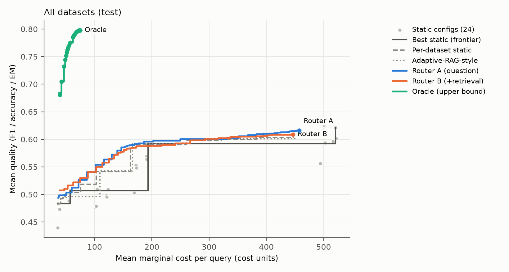
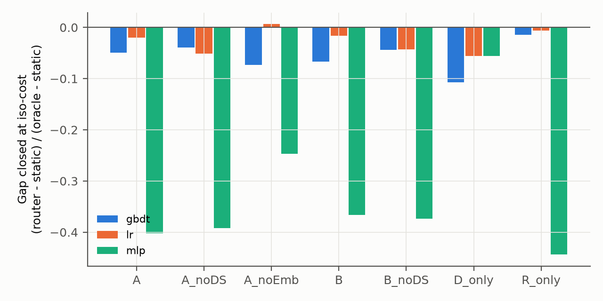
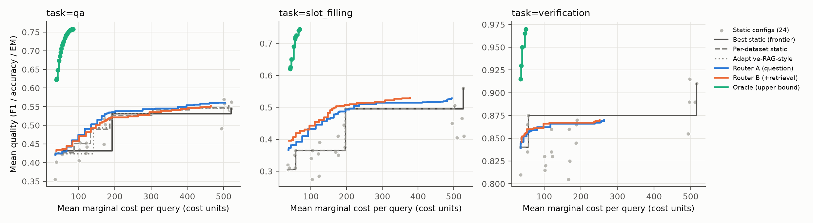
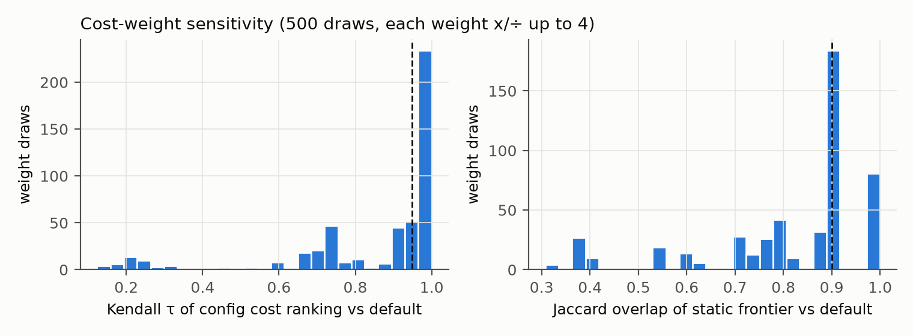
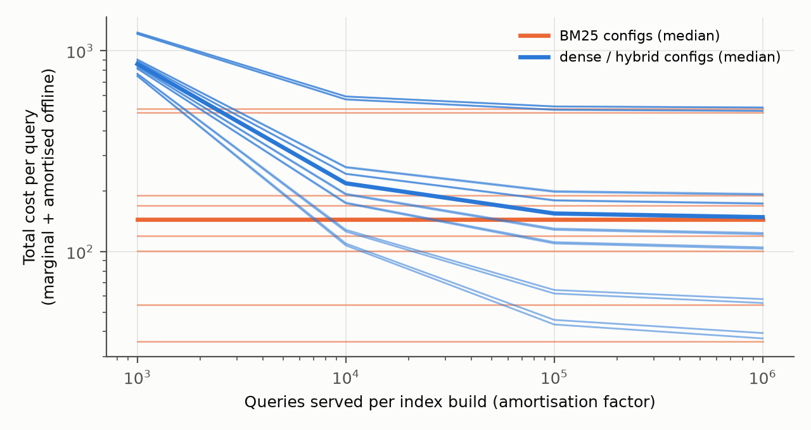

# Which RAG Configuration for Which Query? An End-to-End, Cost-Counted Test of Per-Query Configuration Routing

Final report, Information Retrieval and Extraction, November 2026

**Team Agents:** Samyak Jain (2024101062), Arnav Agnihotri (2024101103), Sherley Sonali Peethala (2023111022)

## Abstract
A retrieval-augmented generation (RAG) system chooses a retriever, a number of passages, whether to rerank, and a
generator. We ran all 24 combinations of these choices on every one of 5,000 questions from five datasets and three
tasks (open-domain QA, fact verification, slot filling), recording each answer's quality and its countable cost. If the
best configuration could be chosen per question, quality would rise from 0.621 to 0.798 (+0.177, 95% CI 0.156–0.199)
while using less than a sixth of the cost. Routers trained to make that choice, from the question alone or with cheap
post-retrieval signals and with their own cost charged, did not beat the best fixed configuration on quality (best
+0.001, CI −0.010 to +0.013). They did match its quality at up to 37% lower marginal cost, and at tight budgets they beat
the static cost–quality frontier by up to 0.08. Most of the saving comes from knowing which dataset a question belongs
to; post-retrieval signals added nothing once their cost was paid. Large per-query headroom that learned routers cannot
recover (the "routing paradox" reported for retrieval alone) therefore also holds for full RAG pipelines, which helps
explain why fixed best-practice recipes work as well as they do.

## 1. Introduction
Benchmark studies (Wang et al., 2024) and tuning tools (AutoRAG; AutoRAG-HP; Orbach et al., 2025; HAMMER, 2026) search
for one good RAG configuration per dataset. A configuration that is best on average may waste cost on easy questions and
be too weak for hard ones. We run every configuration on every question, which turns a sweep into labels: per question,
we know which configurations answer correctly and what each costs. The question is then whether the right configuration
can be predicted for a new question, and what that saves over always using the best fixed configuration.

Two recent papers frame this. BRANE (Pan et al., 2026) routes queries to pipeline configurations by predicting
correctness per configuration minus a cost penalty, the same formulation we use, and reports large savings. RCT-MARS
(Srivastava, 2026) reports a *routing paradox* for retrieval: the per-query oracle beats every fixed retriever by a wide
margin, yet learned routers fall below the best fixed one. We test which picture holds for a full pipeline (retrieval,
reranking and generation), with every cost counted, including the router's own.

**Contributions.**
1. A fully crossed, cost-instrumented grid: 24 configurations × 5,000 questions (120,000 answers) from five datasets and
   three tasks, with per-question quality and exact counts of tokens, LLM calls, reranker pairs and index queries.
2. The oracle ceiling against the best static configuration, per dataset and task, with label statistics.
3. Routers from question-only features (A) and from question plus post-retrieval query-performance signals (B), global
   and per task, three model families, five seeds, against static, per-dataset, per-task and Adaptive-RAG-style
   baselines, with λ chosen on dev and one evaluation on a leakage-controlled test split.
4. A measured cost model that separates per-query (marginal) cost from once-per-corpus (offline) cost, with
   sensitivity to the weights and to the amortisation factor.

## 2. Related work
| Line of work | Representative papers | Relation to this project |
|---|---|---|
| One configuration per dataset | Wang et al. 2024 (EMNLP); AutoRAG (Kim et al. 2024); AutoRAG-HP (Fu et al. 2024); Orbach et al. 2025; Barker et al. 2025; HAMMER (Zhou et al. 2026) | Static search. AutoRAG is our harness. |
| Per-query adaptation | Adaptive-RAG (Jeong et al. 2024); METIS (Ray et al. 2025); Su et al. 2025; RAGRouter (Zhang et al. 2025); RAGRouter-Bench (Wang et al. 2026) | Adaptive-RAG is re-implemented as a baseline. METIS adapts under serving load; we study offline, countable cost. |
| Per-query configuration routing | **BRANE** (Pan et al. 2026); **RCT-MARS** (Srivastava 2026) | BRANE has our cost-penalised formulation (we do not claim it). We test RCT-MARS's routing paradox end to end. |
| Query performance prediction | Clarity (Cronen-Townsend et al. 2002); WIG (Zhou & Croft 2007); NQC (Shtok et al. 2012); QPP for RAG (Arabzadeh et al. 2026) | Router B's retrieval-score signals are post-retrieval QPP predictors. |
| Evaluation | Qian et al. 2026 (budget-aware evaluation of adaptive retrieval); RAGAS (Es et al. 2024) | We report frontiers and realised cost; RAGAS only after human validation. |

The literature was found by pulling all 909 papers that cite six core papers from OpenAlex and screening them by hand
(docs/11), as the TA asked after our proposal missed the 2024 papers.

## 3. Setup

### 3.1 Tasks, datasets and splits
| Task | Datasets (1,000 questions each) | Primary metric (router target) |
|---|---|---|
| Open-domain QA | NQ-open; HotpotQA (multi-hop: 799 bridge, 201 comparison); TriviaQA | token F1 (EM also reported) |
| Fact verification | FEVER (KILT; 497 SUPPORTS, 503 REFUTES) | accuracy (also 2·acc − 1) |
| Slot filling | zsRE (KILT; "subject \| relation" → value) | exact match |

Each dataset is split 600/200/200 into train/dev/test, grouped so that questions sharing a gold Wikipedia article stay on
the same side. No test question shares a gold title with a training question, and no question text appears in two
splits (4,459 groups, the largest with 8 questions).

### 3.2 Corpus
DPR's 100-word passages of the December 2018 English Wikipedia (21,015,324 passages; chunking fixed). We search a
500,000-passage sub-corpus: each question's top-50 passages from BM25 over all 21M passages (our own Lucene index),
the first 10 passages of every gold article, and seeded random passages (226,275 mined, 14,792 gold-article, 258,933
random). The gold passage is in the sub-corpus for 98.6% (HotpotQA), 97.7% (FEVER), 84.1% (zsRE), 79.7% (TriviaQA) and
74.5% (NQ) of questions; the rest are kept to avoid selection bias.

### 3.3 Configuration grid and harness
| Choice | Options |
|---|---|
| Retriever | BM25 (Porter stemmer); dense (`bge-base-en-v1.5`, Chroma); hybrid (reciprocal rank fusion of BM25 top-20 and dense top-20, k = 60) |
| Passages to the generator | top-3 or top-10 |
| Reranker | off; or `ms-marco-MiniLM-L-6-v2` re-scoring a pool of 20 |
| Generator | Qwen2.5-1.5B-Instruct (fp16); Qwen2.5-7B-Instruct-AWQ (4-bit) |

Greedy decoding, at most 32 output tokens, one prompt per task, identical answer post-processing for every
configuration, vLLM 0.11.2 on one RTX 2080 Ti. AutoRAG keeps only the best module after each step, which would leave most
of the grid empty, so we call its modules stage by stage and cache each stage.

**Validity checks.** Two configurations run through AutoRAG's own end-to-end pipeline on 50 questions each gave 100%
identical retrieved passages and 100% identical answers. Re-running a configuration on all 5,000 questions gave 99.74%
identical answers. Our input-token counts equalled vLLM's for both generators (100%). For the 1.5B model, fp32 and fp16
scored 0.860 and 0.862 on the same 1,000 questions, so fp16 was kept.

### 3.4 Metrics, normalisation and statistics
Each per-question score stays on its own [0, 1] scale. Pooled numbers are reported micro (per question), macro over
datasets and macro over tasks (each task weighs the same). We did not z-score or min-max scores: both change when a
configuration is added, and per-question min-max is undefined when all configurations tie. FEVER is also reported as
2·acc − 1 (0 = chance). All comparisons are paired over the same test questions: 10,000 bootstrap resamples stratified
by dataset or task, Holm correction within each family of comparisons.

### 3.5 Cost model
Marginal cost per question = a_in[g]·input tokens + a_out[g]·output tokens + b·LLM calls + c·reranker pairs + d·index
queries, with exact counts and weights measured on the run's GPU and engine (GPU-milliseconds):

| Weight | 1.5B | 7B-AWQ | Note |
|---|---|---|---|
| a_in (per prompt token) | 0.063 | 0.312 | fit R² 0.999 / 0.988 |
| a_out (per generated token) | 0.247 | 2.304 | |
| b (per call) | 0 | 0 | no fixed cost survives the fit |
| c (per reranker pair) | 0.92 | | |
| d (per index query) | 2.7 | | Lucene BM25 2.1 ms; bge-base + Chroma 3.2 ms |

AutoRAG's own retrieval timing (954 ms per query: its BM25 scores all 500k passages in pure Python) measured the harness,
not retrieval, and would have made one lookup cost twice a 7B answer; it is kept only as a sensitivity setting. Building
the indexes is a once-per-corpus cost (embedding 500k passages: 711 GPU-seconds; BM25 build: 472 CPU-seconds; Chroma
1.7 GB, BM25 0.2 GB), reported separately and spread over an explicit number of queries per index build.

## 4. The static landscape and the oracle ceiling
**Main effects (test, mean over the other choices).** The 7B generator adds 0.09 quality at 4.4× the cost (345 vs 79
cost units). Ten passages instead of three add 0.03 at 2.7× the cost. The reranker adds 0.024 at +10%. Hybrid retrieval
beats BM25 by 0.03 at almost the same cost. The best configuration on train, used as the static baseline throughout, is
**hybrid retrieval, top-10, reranker on, 7B** (test quality 0.621, cost 521).

**The oracle ceiling (T3).** Choosing the best configuration per question (ties broken towards the cheaper one):

| Dataset | Best static | Oracle | Headroom [95% CI] | All configs fail | All succeed | Mixed |
|---|---|---|---|---|---|---|
| FEVER | 0.910 | 0.970 | +0.060 [0.030, 0.095] | 3% | 60% | 38% |
| HotpotQA | 0.479 | 0.747 | +0.268 [0.215, 0.324] | 41% | 6% | 54% |
| NQ | 0.447 | 0.695 | +0.248 [0.198, 0.300] | 45% | 3% | 52% |
| TriviaQA | 0.708 | 0.832 | +0.124 [0.085, 0.166] | 24% | 18% | 59% |
| zsRE | 0.560 | 0.745 | +0.185 [0.130, 0.240] | 26% | 5% | 70% |
| **All** | **0.621** | **0.798** | **+0.177 [0.156, 0.199]** | | | |

Macro over tasks, the headroom is +0.153 (+0.173 with chance-corrected FEVER). The oracle reaches its ceiling at a
mean cost of about 75 units, against 521 for the best static configuration (Figure 1): most questions that any
configuration answers are also answered by a cheap one. Between 12 and 21 distinct configurations are oracle-best per
dataset, and no configuration is oracle-best for more than 47% of questions (FEVER; zsRE 44%, QA datasets 26–35%). No claim of the form "for
question type X, configuration Y is best" survives its confidence interval (T7): within every question type, the best
and the runner-up configuration differ by less than their CI.

*Figure 1. Test cost–quality curves: the 24 static configurations (grey), the static frontier, baselines, Router A
(question), Router B (+retrieval signals) and the oracle. Router curves average five seeds.*

## 5. Routing method
One model predicts the quality q̂(question, configuration) for all 24 configurations; the predicted cost is the
configuration's mean training cost within the question's dataset. The router picks argmax q̂ − λ·ĉ/s (s a fixed cost
scale), so one model gives a whole cost–quality curve. Features follow the professor's four groups: (1) question
features (length, question words, entity and number cues, comparison and bridge cues, a 32-dimensional PCA of the
question embedding, a learned multi-hop score); (2) data (dataset and task identity); (3) configuration encoding; (4) the
observed quality and cost, used only as the training target. Router B adds a probe (BM25 top-20 and dense top-20): score
levels, gaps, spread and entropy, query–passage word overlap and BM25–dense agreement. Router A pays one question
embedding unless it picks a dense or hybrid configuration; Router B pays two index queries, and its chosen
configuration's own retrieval is served from the probe (a no-reuse accounting is also reported).

Models: fractional logistic regression with question × configuration interactions (LR), LightGBM (GBDT) and a small MLP,
five seeds each, trained on all tasks (global) and per task. λ is chosen on dev at iso-cost (best quality at no more than
the best static configuration's cost) and iso-quality (lowest cost at no less than its quality), then applied once to
test. Baselines: best static (chosen on train) and its frontier, best static per dataset and per task, an
Adaptive-RAG-style router (a question classifier predicts single-hop / multi-hop / verification / slot filling with test
accuracy 0.887, then uses the best static configuration for that class), cheapest, random, oracle.

## 6. Results

### 6.1 Headline: no router beats the best static configuration on quality
All 5,000 test questions, routers trained on all tasks, λ chosen on dev (T4):

| Router (global) | Iso-cost: Δ quality [95% CI] | its cost saving | Iso-quality: cost saving | Δ quality [95% CI] |
|---|---|---|---|---|
| A, question only (LR) | −0.004 [−0.019, +0.012] | 18% | 22% | −0.009 [−0.024, +0.007] |
| A, without question embedding (LR) | **+0.001 [−0.010, +0.013]** | 12% | 13% | +0.000 [−0.012, +0.012] |
| B, + retrieval signals (LR) | −0.003 [−0.019, +0.013] | 26% | 26% | −0.003 [−0.019, +0.012] |
| A (GBDT) | −0.009 [−0.022, +0.004] | 23% | 24% | −0.011 [−0.024, +0.002] |
| B (GBDT) | −0.012 [−0.025, +0.001] | 26% | 28% | −0.012 [−0.026, +0.001] |
| Dataset identity only (LR) | −0.010 [−0.025, +0.005] | 37% | **37%** | −0.010 [−0.025, +0.005] |
| Retrieval signals only (LR) | −0.001 [−0.013, +0.011] | 12% | 37% | −0.015 [−0.032, +0.001] |
| MLP routers with question or retrieval features | −0.044 to −0.079 (Holm p = 0.004) | | | |

The best static configuration scores 0.621 at a cost of 521. No router improves on it. After Holm correction no
global LR or GBDT router differs significantly from it (two GBDT variants are 0.013–0.019 lower before correction), and
the share of the oracle gap they close lies between −0.11 and +0.006 (Figure 2). The MLP routers that use question or
retrieval features are significantly worse; with squared loss on mostly 0/1 targets they overfit. Per-task LR and GBDT
routers, combined over all test questions, are slightly worse than the global ones (−0.009 to −0.022).

What the routers do deliver is the same quality for less: Router B (LR) saves 26% of marginal cost and the
dataset-identity router saves 37%, with no significant quality loss.

*Figure 2. Gap closed at iso-cost, (router − static)/(oracle − static), per feature set and model (means over five
seeds). A: question features; noDS: without dataset identity; noEmb: without the question embedding; B: + retrieval
signals; D_only: dataset identity only; R_only: retrieval signals only.*

### 6.2 Where routing helps: tight budgets
The headline compares routers with the best (and most expensive) static configuration. Below that cost, the routers'
curves lie above the static frontier (Figure 1; values read from the test curves, so descriptive):

| Budget (mean cost per question) | Static frontier | Per-dataset static | Adaptive-RAG-style | Router A (LR) | Router B (LR) | Oracle |
|---|---|---|---|---|---|---|
| ≤ 100 | 0.507 | 0.519 | 0.496 | 0.550 | 0.545 | 0.798 |
| ≤ 150 | 0.507 | 0.542 | 0.543 | 0.582 | 0.584 | 0.798 |
| ≤ 200 | 0.592 | 0.590 | 0.592 | 0.591 | 0.594 | 0.798 |
| ≤ 600 | 0.621 | 0.610 | 0.603 | 0.620 | 0.622 | 0.798 |

Between 100 and 150 cost units, routing is worth 0.04–0.08 over the best static configuration of that cost, and more
than per-dataset or Adaptive-RAG-style choice. This budget lies between the cost of 1.5B configurations (79 on average)
and 7B ones (345), so the gain most likely comes from choosing which questions get the larger model; once the budget
covers the 7B model for every question, routing has nothing left to add.
By task (Figure 3), the pattern is strongest for zsRE and QA; for FEVER, cheap configurations already reach 0.87 and only
the most expensive one reaches 0.91.

*Figure 3. As Figure 1, per task (global routers).*

### 6.3 What the signals are worth
* **Retrieval signals (Router B) add nothing over the question (H2 not supported).** B and A are within 0.01 of each
  other everywhere, with overlapping intervals, after the probe's two index queries are charged. This matches
  Arabzadeh et al. (2026), who find cheap pre-retrieval predictors often match post-retrieval ones for RAG.
* **Dataset identity carries most of the routing value (H4 supported).** The dataset-only router gives the largest
  saving at matched quality (37%) with quality as close to the best static configuration as any learned router, and
  removing dataset identity lowers the LR routers' quality (A −0.004 → −0.009; B −0.003 → −0.008; for GBDT the change is
  within noise).
* **Gains do not concentrate in multi-hop questions (H3 not supported).** Router B (GBDT) against the best static
  configuration (T6): HotpotQA −0.003 [−0.030, +0.022]; NQ +0.027 [+0.005, +0.051] (Holm p = 0.08); FEVER −0.044
  [−0.080, −0.010] (Holm p = 0.08), driven by SUPPORTS claims (−0.086, Holm p = 0.04).
* Within single tasks, some routers beat that task's best static configuration (FEVER +0.045 [+0.005, +0.090], zsRE
  +0.055 [0.000, +0.110]), but none survives the Holm correction, and the FEVER gain came at twice the cost because the
  dev-chosen λ did not hold its cost on test.

### 6.4 Robustness
* **Cost weights.** Over 500 random perturbations of the weights (each up to ×/÷ 4), the cost ranking of the 24
  configurations keeps a median Kendall τ of 0.95 with the measured weights, and the static frontier keeps a median
  Jaccard overlap of 0.90 (Figure 4). Re-running Routers A and B under three other weight sets (tokens only,
  parameter-scaled, API-price-like) leaves every conclusion unchanged: no quality gain, 16–31% cost saving (T8b). Pricing
  an index query at AutoRAG's 954 ms shrinks Router B's saving from 26% to 4%, because its probe becomes expensive: the
  measured index cost matters.
* **Chance-corrected FEVER.** Scoring FEVER as 2·acc − 1 doubles its weight in task-macro numbers but leaves the
  headline unchanged (T4c).
* **Amortisation (T9, Figure 5).** Dense and hybrid configurations carry the cost of embedding the corpus. At 1,000
  questions per index build they cost about 6× a BM25 configuration (859 vs 145 cost units per question); at 10,000
  about 1.5×; from 100,000 questions the offline cost is negligible.

## 7. LLM-judge metrics
RAGAS faithfulness and answer relevancy were computed with Llama-3.1-8B-Instruct (4-bit AWQ, not from the generators'
model family) on 150 dev items and on 50 test questions per QA and slot-filling dataset × 24 configurations (4,800 items;
FEVER answers are bare labels and are scored by accuracy only). The judge produced scores for over 98% of items, and its
faithfulness score correlates with F1/EM at Spearman 0.39.

**Validation (T11).** With the TA's permission, the labels for the 150 stratified dev items were drafted by an LLM
(Claude) and then reviewed by a human, instead of being labelled independently by two team members. The drafts followed
the annotation guide (docs/05): faithfulness to the passages (0/1/2), relevance (0/1/2) and correctness against the gold
answers (0/1), each judged against the full passages. These are therefore judge-versus-reviewed-label numbers, not
agreement with independent human annotators. With a single set of labels there is no inter-annotator agreement.
Labels: `annotation/ann_llm.xlsx`; report: `final_results/judge/judge_validation_report.json`.

| Agreement (n = 148 items with a judge score) | Value [95% CI] |
|---|---|
| Judge faithfulness vs annotator faithfulness, Spearman | 0.50 [0.35, 0.64] |
| Judge vs annotator, Cohen's κ (judge ≥ 0.5 vs label 2) | 0.48 [0.34, 0.62] |
| EM vs annotator correctness, Cohen's κ | 0.65 |
| EM false-negative rate (annotator: correct, EM = 0) | 26% |
| Token F1 vs annotator correctness, Spearman | 0.81 |

The judge **fails the pre-registered rule** (κ ≥ 0.6 and Spearman CI lower bound > 0.4), so RAGAS is reported only as a
diagnostic and plays no part in any conclusion. Answer relevancy could not be validated: the annotator rated 138 of 150
answers fully relevant, leaving too little variation to correlate. The annotation also quantifies EM's strictness: about
a quarter of answers judged correct score EM = 0 (for example "Liverpool" for "Liverpool FC", or "1211" for "a year in the
life of Genghis Khan"), while token F1 tracks correctness closely (0.81). This supports F1, not EM, as the QA router target.

## 8. Discussion and limitations
The per-question headroom is real and large, but it is not predictable from the question or from cheap retrieval
signals. The oracle's advantage comes from knowing, after the fact, which of many configurations happened to produce a
correct answer, often a cheap one; most of that is not visible in advance. What is predictable is coarse: which dataset
or task a question comes from, and roughly whether it needs the larger model. This is the routing paradox of RCT-MARS,
now for full pipelines with every cost counted. It explains why fixed best-practice recipes perform as well as they do,
and it points to where routing still pays: under a budget below the best configuration's cost.

BRANE reports large savings with the same formulation; its features come from an LLM call per query and its benchmarks
(MuSiQue, BrowseComp-Plus, FinanceBench) differ from ours, so the two results are not in conflict. Whether richer
features can recover the headroom, and at what cost, is the natural next step.

**Limitations.** Chunking is fixed. We search a 500k-passage sub-corpus, so absolute retrieval scores are not comparable
to published numbers, and dense retrieval did not mine its own hard negatives. Both generators come from one family
and the larger one is 4-bit quantised. The data is English Wikipedia only. EM is strict for zsRE. The cost weights belong
to one GPU type and engine, and BM25 index time is CPU time, mixed into GPU-millisecond units. The budget comparison in
§6.2 reads points off test curves, so it is descriptive; the dev-selected comparisons in §6.1 are the tested claims.

## 9. Conclusion
Running all 24 configurations on all 5,000 questions shows a large oracle headroom (+0.177) that learned routers do not
convert into quality. Routers can, however, match the best fixed configuration at about a quarter to a third less cost,
and beat the static frontier at tight budgets, mostly by using dataset identity and choosing the generator size. Charged
at their real cost, post-retrieval signals add nothing over the question.

## Appendix
* A1 Validity: `final_results/checks/` (equivalence, greedy reproducibility, token counts, fp16 check, leakage report).
* A2 All tables T1–T9 as CSV: `final_results/tables/`. Router headline with every policy and mode: `final_results/router_headline.csv`.
* A3 Measured cost weights: `final_results/checks/cost_weights_measured.yaml`.
* A4 Design decisions D1–D24: docs/02. Annotation guide: docs/05. Literature search: docs/11.
* A5 Environment: vLLM 0.11.2, torch 2.9.0 (CUDA 12.8), AutoRAG 0.3.27, ragas 0.2.15, RTX 2080 Ti (Ada, IIIT Hyderabad).

## References
See docs/01_proposal.md, references 1–41.
